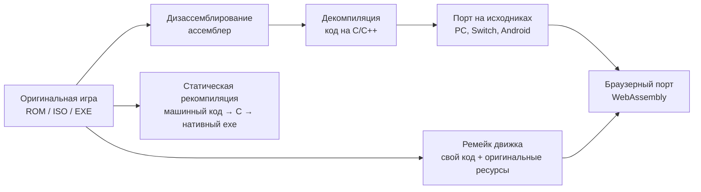

<div align="center">


# 🎮 Декомпиляции и порты игр — каталог и гайд на русском (2026)

**Как играть в Zelda, Mario, Sonic, Diablo, GTA и ещё 1800+ классических игр нативно на ПК, Mac, Linux, Android и в браузере — без эмулятора, в 60+ FPS, широкоформатно и с модами.**

Декомпиляции · статические рекомпиляции · порты на исходниках · движки-ремейки · браузерные порты

[Быстрый старт](#-часть-1-быстрый-старт-за-5-минут) · [Топ-25](#-часть-5-топ-25-во-что-поиграть-прямо-сейчас) · [В браузере](#-часть-6-играть-в-браузере) · [Каталог](#️-часть-7-статические-рекомпиляции) · [По платформам](#-часть-12-лучшее-по-платформам) · [📚 Полный каталог (2118)](catalog/README.md) · [Как декомпилировать](#-часть-14-как-начать-декомпилировать-самому) · [FAQ](#-часть-17-faq)

    

⭐ **Поставь звезду** — так гайд найдут другие.

</div>

> **TL;DR.** Энтузиасты по всему миру «разбирают» старые игры обратно в исходный код (**декомпиляция**) или автоматически переводят машинный код консоли в код для ПК (**статическая рекомпиляция**). Получаются **нативные порты**: Ocarina of Time, Majora's Mask, Mario 64, Sonic Unleashed, Twilight Princess, Diablo, Morrowind работают на Windows, macOS, Linux, Android и Switch лучше оригинала — 60/120 FPS, ultrawide, моды, онлайн-кооп. Сами проекты **не содержат игр**: нужен файл (ROM/образ/данные) от **твоей копии**. Ниже — что это такое, как запустить за 5 минут, рейтинг лучших проектов на русском, каталоги по типам и платформам, мини-курс «как декомпилировать самому», FAQ и глоссарий.[Лучший GAmedev ресурс](https://t.me/+AkELiurycU5iMzUy) - самая большая коллекция уроков по разработке игр от с нуля до профи.

> 🆕 **Октябрь 2026.** В каталоге уже **2118 проектов для 1829 игр**. Главные тренды: волна рекомпиляций Xbox 360 (XenonRecomp/ReXGlue — Skate 3, Lost Odyssey, Fable 2, Forza Horizon), массовые PS1-рекомпиляции, ПК-порт Twilight Princess (**Dusklight**, 5.9k ⭐) на базе декомпиляции `zeldaret/tp`, рекомпиляции Wind Waker HD для ПК и Android.

> [!IMPORTANT]
> Этот репозиторий содержит **только ссылки** на исходный код и страницы проектов. Здесь нет и не будет ROM, ISO, игровых ресурсов и любых других материалов, защищённых авторским правом. Почти всем проектам нужны файлы из **легально купленной** копии игры. Подробнее — в разделе [Юридическая сторона](#️-юридическая-сторона).

## 📑 Содержание

- [📊 Сцена декомпиляций в цифрах](#-сцена-декомпиляций-в-цифрах)
- [🚀 Часть 1. Быстрый старт за 5 минут](#-часть-1-быстрый-старт-за-5-минут)
- [🧠 Часть 2. Что такое декомпиляция, рекомпиляция и порт](#-часть-2-что-такое-декомпиляция-рекомпиляция-и-порт)
- [🎯 Часть 3. Эмулятор, рекомпиляция или порт — что выбрать](#-часть-3-эмулятор-рекомпиляция-или-порт--что-выбрать)
- [💾 Часть 4. Где взять файлы игры (легально)](#-часть-4-где-взять-файлы-игры-легально)
- [🏆 Часть 5. Топ-25: во что поиграть прямо сейчас](#-часть-5-топ-25-во-что-поиграть-прямо-сейчас)
- [🌐 Часть 6. Играть в браузере](#-часть-6-играть-в-браузере)
- [📚 Полный каталог: все проекты по типам и платформам](#-полный-каталог-все-проекты)
- [⚙️ Часть 7. Статические рекомпиляции](#️-часть-7-статические-рекомпиляции)
- [🔧 Часть 8. Порты на исходниках (source ports)](#-часть-8-порты-на-исходниках-source-ports)
- [🏗 Часть 9. Движки-ремейки и реимплементации](#-часть-9-движки-ремейки-и-реимплементации)
- [🔬 Часть 10. Декомпиляции](#-часть-10-декомпиляции)
- [📜 Часть 11. Дизассемблирования](#-часть-11-дизассемблирования)
- [🕹 Часть 12. Лучшее по платформам](#-часть-12-лучшее-по-платформам)
- [🧰 Часть 13. Инструменты и лаунчеры](#-часть-13-инструменты-и-лаунчеры)
- [🎓 Часть 14. Как начать декомпилировать самому](#-часть-14-как-начать-декомпилировать-самому)
- [🧩 Часть 15. Моды и мешапы](#-часть-15-моды-и-мешапы)
- [🛠 Часть 16. Ошибки и их решение](#-часть-16-ошибки-и-их-решение)
- [❓ Часть 17. FAQ](#-часть-17-faq)
- [📖 Часть 18. Глоссарий](#-часть-18-глоссарий)
- [⚖️ Юридическая сторона](#️-юридическая-сторона)
- [🗂 Подробные уроки](#-подробные-уроки)

## 📊 Сцена декомпиляций в цифрах

<!-- STATS:START -->
| Показатель | Значение |
|---|---|
| Проектов в каталоге | **2351** (1999 активных) |
| Уникальных игр | **2005** |
| [Статические рекомпиляции](catalog/rekompilyacii.md) | 673 |
| [Порты на исходниках](catalog/porty.md) | 300 |
| [Движки-ремейки и реимплементации](catalog/remeyki-dvizhkov.md) | 256 |
| [Декомпиляции](catalog/dekompilyacii.md) | 820 |
| [Дизассемблирования](catalog/dizassemblirovaniya.md) | 236 |
| [Браузерные порты](catalog/brauzernye-porty.md) | 58 |
| [Инструменты и лаунчеры](catalog/instrumenty.md) | 8 |
| Играбельны прямо в браузере | 47 |
| Самые «звёздные» | OpenRA — 17.6k ⭐, RollerCoaster Tycoon 2 (OpenRCT2) — 16.5k ⭐ |
| Данные на | 25.10.2026 (обновляются автоматически) |
<!-- STATS:END -->

**Распределение активных проектов по платформам (топ-15):**

| Платформа | Проектов | Платформа | Проектов | Платформа | Проектов |
|---|---|---|---|---|---|
| ПК (Windows) | 295 | GameCube | 87 | DS | 38 |
| Nintendo 64 | 190 | PlayStation 2 | 83 | Xbox | 35 |
| Xbox 360 | 161 | Game Boy Advance | 73 | SNES | 34 |
| PlayStation 1 | 161 | Wii | 58 | Мобильные | 29 |
| DOS | 96 | NES | 53 | Game Boy Color | 25 |

---

## 🚀 Часть 1. Быстрый старт за 5 минут

Три самых популярных проекта, которые показывают, на что способна сцена. Схема у всех одна: **скачал релиз → указал файл своей игры → играешь**.

### Вариант А. Zelda: Majora's Mask — Zelda64Recomp (рекомпиляция N64)

1. Скачай последний релиз со страницы [Zelda64Recomp/Releases](https://github.com/Zelda64Recomp/Zelda64Recomp/releases) (Windows, Linux, macOS).
2. Распакуй и запусти `Zelda64Recompiled`.
3. Нажми **Select ROM** и укажи **свой** дамп Majora's Mask (US-версия, `.z64`).
4. Играй: 60+ FPS, ultrawide, гироскоп, мод-лоадер.

### Вариант Б. Zelda: Ocarina of Time — Ship of Harkinian (порт на основе декомпиляции)

1. Скачай релиз с [HarbourMasters/Shipwright](https://github.com/HarbourMasters/Shipwright/releases) (Windows, macOS, Linux, Switch, Wii U, Android).
2. При первом запуске программа попросит ROM Ocarina of Time и сама извлечёт из него ресурсы в файл `.o2r`.
3. В меню (`F1`) — 60 FPS, широкий экран, рандомайзер, читы, улучшения графики.

### Вариант В. Diablo — DevilutionX (ремейк движка)

1. Скачай релиз [diasurgical/DevilutionX](https://github.com/diasurgical/DevilutionX/releases).
2. Положи рядом файл `DIABDAT.MPQ` из своей копии Diablo (GOG/диск). Нет игры — подойдёт бесплатный `spawn.mpq` из демо-версии.
3. Запускай: современные разрешения, контроллер, мультиплеер, Hellfire.

💡 **Хочешь без установки?** Открой [q3js.com](https://q3js.com/) — Quake III Arena запускается в браузере с демо-данными. Другие браузерные порты — в [части 6](#-часть-6-играть-в-браузере).

### Три пути к первой игре

| Путь | Пример | Время | Сложность | Нужны файлы игры |
|---|---|---|---|---|
| Браузерный порт | q3js, WebXash, isle.pizza | ~1 мин | ⭐ | иногда (есть демо) |
| Готовый релиз рекомпиляции | Zelda64Recomp, UnleashedRecomp | ~5 мин | ⭐ | да |
| Готовый релиз порта / ремейка | Ship of Harkinian, OpenMW, DevilutionX | ~5–10 мин | ⭐⭐ | да |
| Сборка декомпиляции из исходников | zeldaret/oot, pret/pokeemerald | ~30–60 мин | ⭐⭐⭐ | да |

---

## 🧠 Часть 2. Что такое декомпиляция, рекомпиляция и порт

Игры для консолей распространялись в виде **машинного кода** под конкретный процессор (MIPS у N64 и PS1, PowerPC у GameCube, Wii и Xbox 360). Исходники студии почти никогда не публиковались. Сцена нашла несколько способов вернуть игры к жизни.



| Тип | Что это | Нужен оригинал | Пример |
|---|---|---|---|
| **Дизассемблирование** | Машинный код переведён в читаемый ассемблер, который собирается обратно в идентичный ROM | да | [pret/pokered](https://github.com/pret/pokered) |
| **Декомпиляция (matching decomp)** | Код вручную переписан на C/C++ так, что компилятор той эпохи выдаёт **байт-в-байт** тот же бинарник | да (ресурсы) | [zeldaret/oot](https://github.com/zeldaret/oot) |
| **Порт на исходниках (source port)** | Декомпиляция или официально открытый код, доработанный под современные ОС | да (ресурсы) | [Ship of Harkinian](https://github.com/HarbourMasters/Shipwright) |
| **Статическая рекомпиляция** | Инструмент автоматически переводит машинный код в C и компилирует его под ПК; графику и звук обрабатывает свой рантайм | да (ROM/образ) | [Zelda64Recomp](https://github.com/Zelda64Recomp/Zelda64Recomp) |
| **Ремейк движка (reimplementation)** | Движок написан заново (часто clean-room), ресурсы берутся из оригинала | да (ресурсы) | [OpenMW](https://github.com/OpenMW/openmw), [OpenRCT2](https://github.com/OpenRCT2/OpenRCT2) |
| **Браузерный порт** | Порт, собранный в WebAssembly/JS и работающий во вкладке | иногда | [isle.pizza](https://isle.pizza/) |

### Матчинг-декомпиляция: почему это так долго

«Matching» значит, что пересобранный из C код должен **полностью совпасть** с оригиналом. Каждая функция подгоняется вручную: порядок переменных, типы, даже бессмысленные конструкции, которые выдал компилятор 1996 года. Зато результат — эталон: код можно спокойно менять, портировать и улучшать. Декомпиляция Super Mario 64 заняла несколько лет, Ocarina of Time — ещё больше. Прогресс многих проектов виден на [decomp.dev](https://decomp.dev/).

### Статическая рекомпиляция: почему это так быстро

Рекомпилятор (например, **N64Recomp** для N64 или **XenonRecomp** для Xbox 360) берёт бинарник и **механически** переводит каждую инструкцию в C. Результат некрасивый, зато его можно собрать под x86/ARM за недели, а не годы. Рекомпиляция не эмулирует процессор, поэтому работает быстро; графику обычно рисует [RT64](https://github.com/rt64/rt64) или похожий рендерер. Именно поэтому в 2025–2026 годах рекомпиляции растут быстрее всего: **520** проектов против единиц пару лет назад.

| | Матчинг-декомпиляция | Статическая рекомпиляция |
|---|---|---|
| Время до играбельного порта | годы | недели–месяцы |
| Читаемость кода | человеческий C | машинный C |
| Глубокие моды (новая механика) | ✅ легко | ⚠️ через хуки и мод-API |
| Портирование на новые платформы | ✅ | ✅ (x86, ARM) |
| Точность | идеальная (байт-в-байт) | высокая, зависит от рантайма |
| Типичные инструменты | splat, decomp.me, objdiff, m2c | N64Recomp, XenonRecomp, ReXGlue, PS2Recomp |

📖 Подробнее: [docs/01-chto-takoe-dekompilyaciya.md](docs/01-chto-takoe-dekompilyaciya.md)

---

## 🎯 Часть 3. Эмулятор, рекомпиляция или порт — что выбрать

| Критерий | Эмулятор | Рекомпиляция | Порт / декомпиляция | Ремейк движка |
|---|---|---|---|---|
| Поддержка игр | тысячи | одна игра на проект | одна игра на проект | одна игра или серия |
| Производительность | средняя (нужен мощный CPU) | ✅ высокая | ✅ высокая | ✅ высокая |
| 60+ FPS, ultrawide | ⚠️ хаки, часто с багами | ✅ встроено | ✅ встроено | ✅ |
| Моды | ⚠️ патчи ROM | ✅ мод-лоадеры | ✅ максимум | ✅ |
| Работа на слабом железе, Android | ⚠️ | ✅ | ✅ | ✅ |
| Онлайн-кооп | ⚠️ netplay | иногда | ✅ (sm64coopdx) | ✅ (OpenRA, OpenTTD) |
| Точность оригиналу | ✅ | ✅ | ✅ | ⚠️ может отличаться |

💡 **Правило:** если для игры есть зрелый порт или рекомпиляция с рейтингом 4+ — бери её. Если нет — эмулятор. Если проект в статусе WIP (в работе) — смотри раздел Releases и Issues, прежде чем тратить время.

### Как читать рейтинг в таблицах

Рейтинг **score (0–5)** взят из исходного каталога и складывается из играбельности, полноты, активности разработки и популярности. ⭐ — звёзды на GitHub. «Релиз» — есть готовые сборки, ничего компилировать не нужно.

| Score | Что значит |
|---|---|
| 4.5–5.0 | Зрелый проект, можно смело играть |
| 4.0–4.4 | Играбельно, возможны мелкие баги |
| 3.0–3.9 | Ранний релиз или проект для энтузиастов |
| < 3.0 | WIP, исследование, без релиза |

---

## 💾 Часть 4. Где взять файлы игры (легально)

Проекты не содержат игровых ресурсов. Тебе нужна **собственная копия**:

| Платформа | Что нужно | Как получить из своей копии |
|---|---|---|
| NES, SNES, N64, GB/GBC/GBA | ROM-файл (`.nes`, `.sfc`, `.z64`, `.gba`) | Дампер картриджей (например, open-source Sanni Cart Reader) |
| PS1, PS2 | Образ диска (`.bin/.cue`, `.iso`) | Снять образ со своего диска в ПК-приводе |
| GameCube, Wii | Образ (`.iso`, `.rvz`) | Дамп диска на своей консоли с homebrew |
| Xbox 360 | Образ или распакованные файлы, `default.xex` | Дамп диска со своей консоли / привода |
| ПК, DOS | Файлы установленной игры | GOG, Steam, оригинальный диск |
| Switch, Wii U, 3DS | Дамп ROMFS/EXEFS | Дамп со своей консоли |

**Проверяй версию и хэш.** Многие рекомпиляции требуют конкретную версию (часто — US, rev. 0). В README проекта обычно указан SHA-1 или MD5. Проверка:

```bash
# Windows (PowerShell)
Get-FileHash .\game.z64 -Algorithm SHA1
# macOS / Linux
shasum -a 1 game.z64
```

**Формат N64-ромов:** `.z64` — прямой порядок байт (нужен почти всем проектам), `.v64` и `.n64` — перевёрнутый. Конвертировать можно утилитами вроде Tool64 или онлайн-конвертеров с проверкой хэша.

⚠️ Не скачивай «готовые сборки с вшитой игрой» и не устанавливай лаунчеры, которые навязывают сайты: это частый способ распространения вредоносного ПО.

---
## 🏆 Часть 5. Топ-25: во что поиграть прямо сейчас

Проекты с лучшим сочетанием играбельности, полноты, активности и популярности. У всех есть готовые релизы; файлы игры нужны свои.

| # | Игра (проект) | Тип | Платформа | ⭐ | Score | Почему стоит |
|---|---|---|---|---|---|---|
| 1 | [The Legend of Zelda: Ocarina of Time — Ship of Harkinian](https://github.com/HarbourMasters/Shipwright) | Декомпиляция → порт | N64 / GC | 5.6k | 4.2 | Лучший способ играть в OoT на ПК, Switch, Wii U и Android: 60 FPS, широкий экран, рандомайзер, моды |
| 2 | [The Legend of Zelda: Majora's Mask — Zelda64Recomp](https://github.com/Zelda64Recomp/Zelda64Recomp) | Рекомпиляция | N64 | 7.4k | 4.8 | Ultrawide, высокий FPS, гироскоп, мод-лоадер |
| 3 | [Sonic Unleashed — Unleashed Recompiled](https://github.com/hedge-dev/UnleashedRecomp) | Рекомпиляция | Xbox 360 | 5.2k | 4.5 | Версия с Xbox 360 на ПК: высокий FPS, ultrawide, моды |
| 4 | [Super Mario 64 — sm64coopdx](https://github.com/coop-deluxe/sm64coopdx) | Декомпиляция → порт | N64 | 1.4k | 4.0 | Онлайн-кооп до 16 игроков, Lua-моды, DynOS |
| 5 | [Star Fox 64 — Starship](https://github.com/HarbourMasters/Starship) | Декомпиляция → порт | N64 | 2.1k | 4.2 | Нативный порт с широким экраном и 60 FPS |
| 6 | [The Legend of Zelda: Twilight Princess — Dusklight](https://github.com/TwilitRealm/dusklight) | Порт | GameCube | 5.9k | 4.8 | ПК/мобильный порт на базе декомпиляции zeldaret/tp |
| 7 | [Banjo-Kazooie — BanjoRecomp](https://github.com/BanjoRecomp/BanjoRecomp) | Рекомпиляция | N64 | 2.0k | 4.5 | Windows/Linux/Mac, широкий экран, моды через Thunderstore |
| 8 | [Mario Kart 64 — SpaghettiKart](https://github.com/HarbourMasters/SpaghettiKart) | Порт | N64 | 2.4k | 4.3 | HD, свои трассы, больше игроков, моддинг |
| 9 | [Diablo — DevilutionX](https://github.com/diasurgical/DevilutionX) | Ремейк движка | ПК | 9.9k | 4.8 | Diablo и Hellfire на ПК, консолях и портативках |
| 10 | [RollerCoaster Tycoon 2 — OpenRCT2](https://github.com/OpenRCT2/OpenRCT2) | Ремейк движка | ПК | 16.4k | 4.8 | Мультиплеер, высокие разрешения, удобства |
| 11 | [The Legend of Zelda: A Link to the Past — zelda3](https://github.com/snesrev/zelda3) | Реимплементация | SNES | 4.9k | 4.5 | Код на C: широкий экран, шейдеры, MSU-1 |
| 12 | [The Elder Scrolls III: Morrowind — OpenMW](https://github.com/OpenMW/openmw) | Ремейк движка | ПК | 6.6k | 4.8 | Выше производительность, Lua-моддинг, Linux/macOS/Android |
| 13 | [Sonic Mania — декомпиляция](https://github.com/RSDKModding/Sonic-Mania-Decompilation) | Декомпиляция | ПК | 816 | 4.0 | Нативные сборки для ПК, Switch, Android |
| 14 | [Transport Tycoon Deluxe — OpenTTD](https://github.com/OpenTTD/OpenTTD) | Ремейк движка | ПК | 8.4k | 4.8 | Бесплатная графика OpenGFX — оригинал не нужен |
| 15 | [Sonic the Hedgehog (2006) — Marathon Recompiled](https://github.com/sonicnext-dev/MarathonRecomp) | Рекомпиляция | Xbox 360 | 676 | 3.4 | Исправляет производительность и загрузки «Sonic 06» |
| 16 | [LEGO Island — isle-portable](https://github.com/isledecomp/isle-portable) | Порт | ПК | 1.1k | 4.3 | Windows, Linux, macOS, браузер, консоли |
| 17 | [Heroes of Might and Magic III — VCMI](https://github.com/vcmi/vcmi) | Ремейк движка | ПК | 5.9k | 4.5 | HD, моды, мультиплеер, Android |
| 18 | [Carmageddon — dethrace](https://github.com/dethrace-labs/dethrace) | Ремейк движка | ПК | 1.2k | 4.5 | Нативно на Windows, Linux, macOS |
| 19 | [3D Pinball Space Cadet](https://github.com/k4zmu2a/SpaceCadetPinball) | Декомпиляция | ПК | 4.7k | 3.6 | Тот самый пинбол из Windows XP на любых ОС |
| 20 | [Theme Hospital — CorsixTH](https://github.com/CorsixTH/CorsixTH) | Ремейк движка | ПК | 4.6k | 4.3 | Высокие разрешения, редактор кампаний |
| 21 | [Caesar III — Julius](https://github.com/bvschaik/julius) | Ремейк движка | ПК | 3.4k | 4.5 | Точная реимплементация с исправленными багами |
| 22 | [Quake III Arena — q3js](https://q3js.com/) | Браузерный порт | ПК | — | 4.0 | Играешь в браузере в один клик, демо-данные встроены |
| 23 | [Command & Conquer, Red Alert, Dune 2000 — OpenRA](https://github.com/OpenRA/OpenRA) | Ремейк движка | ПК | 17.6k | 4.5 | Классические RTS Westwood с онлайном и балансом |
| 24 | [Jak & Daxter — OpenGOAL](https://github.com/open-goal/jak-project) | Декомпиляция | PS2 | 3.6k | 4.2 | Jak 1–2 нативно на ПК в высоком FPS |
| 25 | [Majora's Mask — 2 Ship 2 Harkinian](https://github.com/2ship2harkinian/2ship2harkinian) | Декомпиляция → порт | N64 | 2.3k | 4.2 | Порт MM от авторов Ship of Harkinian |

---

## 🌐 Часть 6. Играть в браузере

Эти игры запускаются прямо во вкладке (WebAssembly/JS). Ссылки в исходном каталоге проверяются ежедневно, но сайты сторонние: **никогда не устанавливай лаунчеры и расширения, которые они предлагают**.

| Игра | Платформа | Ссылка | Что нужно |
|---|---|---|---|
| Quake III Arena (q3js) | ПК | [q3js.com](https://q3js.com/) | ничего, мультиплеер |
| Star Wars Jedi Knight: Jedi Academy | ПК | [jk.q3js.com](https://jk.q3js.com) | свои файлы игры, мультиплеер |
| Half-Life и Counter-Strike 1.6 (WebXash) | ПК | [webXash](http://x8bitrain.github.io/webXash/) | бесплатное демо |
| Half-Life (pixelsuft) | ПК | [pixelsuft.github.io/hl](http://pixelsuft.github.io/hl/) | свои файлы игры |
| Diablo (diabloweb) | ПК | [d07riv.github.io/diabloweb](https://d07riv.github.io/diabloweb/) | бесплатное демо или свой `DIABDAT.MPQ` |
| NetQuake.io | ПК | [netquake.io](https://www.netquake.io/) | бесплатное демо |
| QuakeWorld / Quake II / RTCW | ПК | [q1.pieter.com](http://q1.pieter.com) · [q2](http://q2.pieter.com) · [rtcw](http://rtcw.pieter.com) | мультиплеер |
| Urban Terror | ПК | [ut.pieter.com](http://ut.pieter.com) | ничего (игра бесплатная) |
| Doom (WadCMD) | ПК | [wadcmd.com](https://wadcmd.com/) | свой WAD или Freedoom |
| Doom Multiplayer (Silent Space Marine) | ПК | [silentspacemarine.com](https://silentspacemarine.com/) | мультиплеер |
| LEGO Island | ПК | [isle.pizza](https://isle.pizza/) | свои файлы игры |
| Command & Conquer: Red Alert 2 (Chrono Divide) | ПК | [chronodivide.com](https://chronodivide.com/) | свои файлы игры, мультиплеер |
| C&C Generals Zero Hour | ПК | [generals.wasm.ltd](https://generals.wasm.ltd) | свои файлы игры, мультиплеер |
| Halo: Combat Evolved | Xbox | [Halo CE web](https://mitchellhynes.com/halo/halo.html) | свои файлы игры |
| The Simpsons: Hit & Run | ПК | [shar-wasm](http://shar-wasm.cjoseph.workers.dev/?skipmovie) | свои файлы игры |
| Zelda II: The Adventure of Link (z2rs) | NES | [z2rs.com](https://z2rs.com/) | свой ROM |
| Crash Bash Online | PS1 | [crashbash.app](https://crashbash.app/) | мультиплеер |
| RuneScape Classic | ПК | [runescapeclassic.gold](https://runescapeclassic.gold/) | мультиплеер |

**Браузерные порты с открытым кодом:**

| Проект | Платформа | ⭐ | Score |
|---|---|---|---|
| [pokeemerald-wasm](https://github.com/tripplyons/pokeemerald-wasm) — Pokémon Emerald | GBA | 310 | 4.35 |
| [lba2remake](https://github.com/LBALab/lba2remake) — Little Big Adventure 2 | DOS | 286 | 4.15 |
| [hit-and-run-web](https://github.com/Vheissu/hit-and-run-web) — The Simpsons: Hit & Run | ПК | 161 | 4.15 |
| [isle.pizza](https://github.com/isledecomp/isle.pizza) — LEGO Island | ПК | 55 | 4.15 |
| [battlecity](https://github.com/vgrichina/battlecity) — Battle City (Танчики) | NES | 10 | 3.55 |
| [doom.wasm](https://github.com/jacobenget/doom.wasm) — Doom | DOS | 11 | 3.3 |

---

## 📚 Полный каталог: все проекты

Ниже в частях 7–12 — **лучшие** проекты с пояснениями. Полный список всех проектов (включая неактивные) лежит в папке [`catalog/`](catalog/README.md) и **обновляется автоматически каждый день** через GitHub Actions.

| По типу | По платформе |
|---|---|
| [⚙️ Статические рекомпиляции](catalog/rekompilyacii.md) | [Nintendo 64](catalog/platformy/n64.md) · [GameCube и Wii](catalog/platformy/gamecube-wii.md) · [Wii U, 3DS, DS, Switch](catalog/platformy/wiiu-3ds-switch.md) |
| [🔬 Декомпиляции](catalog/dekompilyacii.md) | [NES и SNES](catalog/platformy/nes-snes.md) · [Game Boy, GBC, GBA](catalog/platformy/game-boy.md) |
| [🔧 Порты на исходниках](catalog/porty.md) | [PlayStation 1](catalog/platformy/ps1.md) · [PlayStation 2](catalog/platformy/ps2.md) · [PS3, PS4, PSP](catalog/platformy/ps3-ps4-psp.md) |
| [🏗 Движки-ремейки](catalog/remeyki-dvizhkov.md) | [Xbox](catalog/platformy/xbox.md) · [Xbox 360](catalog/platformy/xbox-360.md) · [Sega](catalog/platformy/sega.md) |
| [📜 Дизассемблирования](catalog/dizassemblirovaniya.md) | [ПК](catalog/platformy/pc.md) · [DOS](catalog/platformy/dos.md) · [Аркады](catalog/platformy/arcade.md) |
| [🌐 Браузерные порты](catalog/brauzernye-porty.md) · [🧰 Инструменты](catalog/instrumenty.md) | [Мобильные](catalog/platformy/mobile.md) · [Ретро-компьютеры](catalog/platformy/retro-pc.md) · [Другие](catalog/platformy/other.md) |

---

## ⚙️ Часть 7. Статические рекомпиляции

Бинарники консолей и ПК, статически перекомпилированные в нативный код (N64Recomp, XenonRecomp, ReXGlue, рекомпиляторы PS1/PS2). Всего в каталоге **520**; ниже — лучшие по рейтингу. Полный список — [catalog/rekompilyacii.md](catalog/rekompilyacii.md). «✅» в колонке «Релиз» — есть готовые сборки.

> ⚠️ Многие рекомпиляции появились в 2026 году и развиваются очень быстро. Перед запуском смотри Issues проекта, а exe-файлы скачивай только из раздела Releases официального репозитория.

| Игра | Платформа | ⭐ | Score | Релиз |
|---|---|---|---|---|
| [The Legend of Zelda: Majora's Mask](https://github.com/Zelda64Recomp/Zelda64Recomp) | N64 | 7.4k | 4.75 | ✅ |
| [Sonic Unleashed](https://github.com/hedge-dev/UnleashedRecomp) | Xbox 360 | 5.2k | 4.55 | ✅ |
| [Banjo-Kazooie](https://github.com/BanjoRecomp/BanjoRecomp) | N64 | 2.0k | 4.55 | ✅ |
| [Skate 3](https://github.com/mchughalex/skate3recomp) | Xbox 360 | 1.6k | 4.55 | ✅ |
| [Castlevania: Symphony of the Night](https://github.com/BlackLabelHQ/SymphonyRecomp) | PS1 | 895 | 4.35 | ✅ |
| [Blue Dragon](https://github.com/zolaware/reblue) | Xbox 360 | 796 | 4.35 | ✅ |
| [Ace Combat 6: Fires of Liberation](https://github.com/sal063/AC6_recomp) | Xbox 360 | 522 | 4.35 | — |
| [Donkey Kong 64](https://github.com/Rainchus/Donkey-Kong-64-Recompiled) | N64 | 510 | 4.35 | ✅ |
| [Pokémon Gold / Silver / Crystal (Gen2Recomped)](https://github.com/UNDERdecoded/Gen2Recomped) | GBC | 387 | 4.35 | ✅ |
| [Star Wars: TIE Fighter (OpenTIE)](https://github.com/elyosh/OpenTIE) | DOS | 330 | 4.35 | ✅ |
| [Dinosaur Planet](https://github.com/DinosaurPlanetRecomp/dino-recomp) | N64 | 327 | 4.35 | ✅ |
| [SpeedBreaker](https://github.com/SpeedBreakerProject/speedbreaker) | Xbox 360 | 321 | 4.35 | ✅ |
| [Mystical Ninja Starring Goemon](https://github.com/klorfmorf/Goemon64Recomp) | N64 | 315 | 4.35 | ✅ |
| [Viva Piñata: Trouble in Paradise](https://github.com/SolarCookies/TiP-Recomp) | Xbox 360 | 209 | 4.35 | ✅ |
| [Call of Duty 3](https://github.com/FrankHUN88453/CoD3Recomp) | Xbox 360 | 203 | 4.35 | — |
| [Need for Speed II: Special Edition](https://github.com/zaps166/NFSIISE) | ПК | 768 | 4.15 | ✅ |
| [The Legend of Zelda: The Wind Waker HD](https://github.com/ZeldaWWHDRecomp/ZeldaWWHDRecomp) | Wii U | 693 | 4.15 | ✅ |
| [Forza Horizon (pinyon-shift)](https://github.com/arcanite24/pinyon-shift) | Xbox 360 | 668 | 4.15 | ✅ |
| [Lost Odyssey](https://github.com/freefrank/LostOdysseyRecomp) | Xbox 360 | 622 | 4.15 | ✅ |
| [Mario Kart 64](https://github.com/sonicdcer/MarioKart64Recomp) | N64 | 611 | 4.0 | ✅ |
| [Ocarina of Time 3D (TriAevum)](https://github.com/coccofresco/TriAevum) | 3DS | 490 | 4.15 | — |
| [Super Smash Bros. Melee (MeleePC)](https://github.com/999sian/melee-pc) | GameCube | 470 | 4.15 | — |
| [Fable 2](https://github.com/himdo/Fable-2-Recomp) | Xbox 360 | 449 | 4.15 | ✅ |
| [Star Fox 64](https://github.com/sonicdcer/Starfox64Recomp) | N64 | 383 | 4.1 | ✅ |
| [The Legend of Zelda: The Wind Waker (bluewake)](https://github.com/chrissotraidis/bluewake) | GameCube | 377 | 4.15 | ✅ |
| [The Simpsons Game](https://github.com/YesterMester/TheSimpsonsGameRecomp) | Xbox 360 | 352 | 4.1 | ✅ |
| [Ico (Ico-PC)](https://github.com/nathanialf/ico-pc) | PS2 | 332 | 4.15 | ✅ |
| [Silent Hill: Downpour](https://github.com/LittleBitUA/DownpourRecomp) | Xbox 360 | 291 | 4.15 | ✅ |
| [Mega Man 64](https://github.com/MegaMan64Recomp/MegaMan64Recompiled) | N64 | 270 | 3.9 | ✅ |
| [Metroid Prime Hunters](https://github.com/mstan/MetroidPrimeHuntersRecomp) | DS | 260 | 4.15 | ✅ |
| [Donkey Kong Country](https://github.com/elliotttate/DKC1Recomp) | SNES | 240 | 4.15 | ✅ |
| [GTA: Liberty City Stories (LCS Recomp)](https://github.com/elmasas/lcs-recomp) | PSP | 226 | 4.15 | ✅ |
| [Need for Speed: Most Wanted (nfsmw-nx)](https://github.com/StevensND/nfsmw-nx) | Xbox 360 | 228 | 3.75 | ✅ |
| [Condemned 2: Bloodshot](https://github.com/psxrestore/Condemned2Recomp) | Xbox 360 | 222 | 3.75 | ✅ |
| [Project Gotham Racing 4](https://github.com/beatrixzy/PGR4-Recomp) | Xbox 360 | 180 | 4.15 | ✅ |
| [MediEvil](https://github.com/BlackLabelHQ/MediEvilRecomp) | PS1 | 179 | 3.55 | ✅ |
| [Mega Man X](https://github.com/mstan/MegaManXSNESRecomp) | SNES | 184 | 3.95 | ✅ |
| [Kirby's Return to Dream Land](https://github.com/ExpansionPak/ModernGekko) | Wii | 169 | 3.55 | ✅ |
| [Harvest Moon 64](https://github.com/HarvestMoon64Recomp/HarvestMoon64Recomp) | N64 | 162 | 4.15 | ✅ |
| [Deadly Premonition](https://github.com/LittleBitUA/DPRecomp) | Xbox 360 | 162 | 3.95 | ✅ |
| [Banjo-Kazooie: Nuts & Bolts](https://github.com/masterspike52/reNut) | Xbox 360 | 156 | 4.15 | ✅ |
| [Star Wars: X-Wing Alliance (OpenXWA)](https://github.com/elyosh/OpenXWA) | ПК | 153 | 4.15 | ✅ |
| [Bomberman 64](https://github.com/RevoSucks/BM64Recomp) | N64 | 298 | 3.55 | ✅ |
| [Quest 64](https://github.com/Rainchus/Quest64-Recomp) | N64 | 280 | 3.75 | ✅ |
| [Eternal Sonata](https://github.com/birabittoh/EternalSonataReprise) | Xbox 360 | 137 | 4.15 | ✅ |
| [Yu-Gi-Oh! Forbidden Memories](https://github.com/Unchiga/YuGiOhForbiddenMemoriesRecomp) | PS1 | 137 | 4.15 | ✅ |
| [Syphon Filter](https://github.com/Madxbio97/SF-pc-port) | PS1 | 123 | 4.15 | ✅ |
| [Alone in the Dark (ReHaunted)](https://github.com/spacefarergames/AloneInTheDarkReHaunted) | DOS | 120 | 4.15 | ✅ |
| [Super Mario World](https://github.com/mstan/SuperMarioWorldRecomp) | SNES | 114 | 3.95 | ✅ |
| [Super Metroid](https://github.com/mstan/SuperMetroidRecomp) | SNES | 110 | 3.95 | ✅ |
| [Pokémon Snap](https://github.com/JackandBeans/Snap64Recomp) | N64 | 109 | 3.95 | ✅ |
| [Snowboard Kids 2](https://github.com/cdlewis/snowboardkids2-recomp) | N64 | 108 | 3.9 | ✅ |
| [Need for Speed: Underground 2](https://github.com/codepdbh/nfsu2-recompiled) | ПК | 102 | 3.9 | ✅ |
| [Jet Set Radio Future (JSRF Unleashed)](https://github.com/JuMatt/JetSetRadioFuture-Unleashed) | Xbox | 92 | 4.15 | ✅ |
| [Ridge Racer 6](https://github.com/Sirhalo23/RidgeRacer6-Recompilation) | Xbox 360 | 92 | 4.15 | ✅ |
| [Mega Man X4](https://github.com/mstan/MegaManX4Recomp) | PS1 | 94 | 3.95 | ✅ |
| [Call of Duty: Modern Warfare 2](https://github.com/PaulCombal/mw2-recompiled) | Xbox 360 | 86 | 4.15 | ✅ |
| [Ape Escape](https://github.com/mstan/ApeEscapeRecomp) | PS1 | 87 | 3.95 | ✅ |
| [Crash Bandicoot 2](https://github.com/Zumbo06/Crash2Recomp) | PS1 | 86 | 3.95 | ✅ |
| [GoldenEye 007 (goldeneye-metal)](https://github.com/ysrdevs/goldeneye-metal) | N64 | 85 | 4.15 | ✅ |
| [Wave Race 64](https://github.com/danielgomesvieira2000/wave-race-64-recomp) | N64 | 85 | 3.95 | ✅ |
| [Grand Theft Auto IV (Theft4)](https://github.com/KoreanSeats1/Theft4) | Xbox 360 | 80 | 4.15 | ✅ |
| [Tomba!](https://github.com/mstan/TombaRecomp) | PS1 | 67 | 3.95 | ✅ |
| [Mario Kart: Super Circuit](https://github.com/mstan/MarioKartSuperCircuitRecomp) | GBA | 67 | 3.95 | ✅ |
| [Dragon Quest VIII](https://github.com/Sinan-Karakaya/DQ8-Recompiled) | PS2 | 61 | 4.15 | ✅ |
| [Resident Evil 3: Nemesis](https://github.com/BrazilianHobbyist/Project-RE-Visited-RE3) | PS1 | 59 | 4.15 | ✅ |
| [Silent Hill 2 (sh2-nx)](https://github.com/cutarev/sh2-nx) | PS2 | 30 | 4.15 | ✅ |
| [Mass Effect (masseffect-nx)](https://github.com/nebadasSwifty/masseffect-nx) | Xbox 360 | 30 | 4.15 | ✅ |

**Серии PS1-рекомпиляций:** [alexbeavs-ps1-ports](https://github.com/alexbeavs-ps1-ports/psxrecomp-ports) — Metal Gear Solid, Final Fantasy VIII/IX, Dino Crisis 1–2, Parasite Eve, Suikoden 1–2, Crash 3 и др.; [mstan](https://github.com/mstan) — десятки рекомпиляций NES/SNES/GBA/PS1 (Zelda, Metroid, Mega Man, Sonic, Pokémon).

---
## 🔧 Часть 8. Порты на исходниках (source ports)

Нативные порты для ПК и портативок, собранные на основе декомпиляции или официально открытого кода. Всего **230** — [полный список](catalog/porty.md).

| Игра (проект) | Платформа оригинала | ⭐ | Score | Релиз |
|---|---|---|---|---|
| [VVVVVV](https://github.com/TerryCavanagh/VVVVVV) | ПК | 8.0k | 4.75 | ✅ |
| [The Legend of Zelda: Twilight Princess — Dusklight](https://github.com/TwilitRealm/dusklight) | GameCube | 5.9k | 4.75 | ✅ |
| [Warzone 2100](https://github.com/Warzone2100/warzone2100) | ПК | 4.0k | 4.8 | ✅ |
| [ioquake3](https://github.com/ioquake/ioq3) — Quake III Arena | ПК | 2.8k | 4.2 | — |
| [Chocolate Doom](https://github.com/chocolate-doom/chocolate-doom) | DOS | 2.4k | 4.55 | ✅ |
| [Mario Kart 64 — SpaghettiKart](https://github.com/HarbourMasters/SpaghettiKart) | N64 | 2.4k | 4.35 | ✅ |
| [Fallout 2 — fallout2-ce](https://github.com/alexbatalov/fallout2-ce) | ПК | 2.5k | 4.15 | ✅ |
| [OpenJK](https://github.com/JACoders/OpenJK) — Jedi Outcast / Jedi Academy | ПК | 2.3k | 4.55 | ✅ |
| [vkQuake](https://github.com/Novum/vkQuake) — Quake на Vulkan | DOS | 2.3k | 4.55 | ✅ |
| [dhewm3](https://github.com/dhewm/dhewm3) — Doom 3 | ПК | 2.2k | 4.35 | ✅ |
| [Perfect Dark](https://github.com/perfect-dark-pc-port/perfect_dark) | N64 | 2.1k | 4.3 | ✅ |
| [Quake3e](https://github.com/ec-/Quake3e) | ПК | 1.5k | 4.55 | ✅ |
| [Animal Crossing — ACGC-PC-Port](https://github.com/flyngmt/ACGC-PC-Port) | GameCube | 1.5k | 4.35 | — |
| [C&C Generals — GeneralsGameCode](https://github.com/TheSuperHackers/GeneralsGameCode) | ПК | 1.4k | 4.55 | ✅ |
| [OpenBOR](https://github.com/DCurrent/openbor) — Beats of Rage | ПК | 1.3k | 4.55 | ✅ |
| [The Force Engine](https://github.com/TheForceEngine/TheForceEngine) — Star Wars: Dark Forces | DOS | 1.2k | 4.55 | ✅ |
| [Mario Kart Wii — Wiicompiled](https://github.com/patchzyy/Wiicompiled) | Wii | 1.2k | 4.35 | ✅ |
| [LEGO Island — isle-portable](https://github.com/isledecomp/isle-portable) | ПК | 1.1k | 4.35 | ✅ |
| [vkQuake2](https://github.com/kondrak/vkQuake2) | ПК | 1.0k | 4.55 | ✅ |
| [Yamagi Quake II](https://github.com/yquake2/yquake2) | ПК | 1.0k | 4.2 | — |
| [Crispy Doom](https://github.com/fabiangreffrath/crispy-doom) | DOS | 961 | 4.35 | ✅ |
| [Raze](https://github.com/ZDoom/Raze) — Duke Nukem 3D, Blood, Shadow Warrior | DOS | 887 | 4.15 | ✅ |
| [Super Mario 64 — Ghostship](https://github.com/HarbourMasters/Ghostship) | N64 | 825 | 4.35 | ✅ |
| [NBlood](https://github.com/NBlood/NBlood) — Blood | DOS | 810 | 4.35 | ✅ |
| [Doom Retro](https://github.com/bradharding/doomretro) | DOS | 776 | 4.35 | ✅ |
| [Zelda: The Minish Cap для 3DS](https://github.com/EstebanPdN/zelda-tmc-3ds) | GBA | 750 | 4.35 | ✅ |
| [Zelda: A Link to the Past для 3DS](https://github.com/EstebanPdN/zelda-alttp-3ds) | SNES | 711 | 4.35 | ✅ |
| [dsda-doom](https://github.com/dsda-org/dsda-doom) | DOS | 511 | 4.35 | ✅ |
| [FS2Open](https://github.com/scp-fs2open/fs2open.github.com) — FreeSpace 2 | ПК | 492 | 4.35 | ✅ |
| [Metroid Prime Port](https://github.com/Odrannnn/MetroidPrimePort) | GameCube | 439 | 4.15 | ✅ |
| [TheXTech](https://github.com/TheXTech/TheXTech) — Super Mario Bros. X | ПК | 419 | 4.35 | ✅ |
| [Super Mario Strikers — PC Port](https://github.com/new-coke/strikers) | GameCube | 330 | 4.15 | ✅ |
| [Odamex](https://github.com/odamex/odamex) — мультиплеерный Doom | DOS | 303 | 4.35 | ✅ |
| [GoldenEye PC Port](https://github.com/jkdansereau/goldeneye-pc-port) | N64 | 255 | 4.15 | ✅ |
| [Lambda1VR](https://github.com/Team-Beef-Studios/Lambda1VR) — Half-Life в VR | ПК | 245 | 4.35 | ✅ |
| [Pikmin — Open Nectar](https://github.com/SSunnKing/Open-Nectar---Pikmin-Native-PC-Mobile-Port) | GameCube | 233 | 4.15 | ✅ |
| [Spelunky Classic HD](https://github.com/yancharkin/SpelunkyClassicHD) | ПК | 225 | 4.35 | ✅ |
| [Crash Team Racing — High Octane](https://github.com/Rinnegatamante/Crash-Team-Racing-High-Octane) | PS1 | 193 | 4.15 | ✅ |
| [Descent 3 — PiccuEngine](https://github.com/InsanityBringer/PiccuEngine) | ПК | 161 | 4.15 | ✅ |
| [ReflectionHLE](https://github.com/ReflectionHLE/ReflectionHLE) — Wolfenstein 3D, Commander Keen | DOS | 138 | 4.15 | ✅ |

---

## 🏗 Часть 9. Движки-ремейки и реимплементации

Движок написан заново (часто методом clean-room), а графика, звук и уровни берутся из оригинала. Всего **206** — [полный список](catalog/remeyki-dvizhkov.md). Это самая зрелая часть сцены: многим проектам больше 10 лет.

| Игра (проект) | Платформа | ⭐ | Score | Релиз |
|---|---|---|---|---|
| [OpenRA](https://github.com/OpenRA/OpenRA) — C&C, Red Alert, Dune 2000 | ПК | 17.6k | 4.5 | ✅ |
| [OpenRCT2](https://github.com/OpenRCT2/OpenRCT2) — RollerCoaster Tycoon 2 | ПК | 16.4k | 4.75 | ✅ |
| [openage](https://github.com/SFTtech/openage) — Age of Empires | ПК | 14.5k | 4.75 | ✅ |
| [DevilutionX](https://github.com/diasurgical/DevilutionX) — Diablo | ПК | 9.9k | 4.75 | ✅ |
| [OpenTTD](https://github.com/OpenTTD/OpenTTD) — Transport Tycoon Deluxe | ПК | 8.4k | 4.75 | ✅ |
| [OpenMW](https://github.com/OpenMW/openmw) — Morrowind | ПК | 6.6k | 4.75 | ✅ |
| [VCMI](https://github.com/vcmi/vcmi) — Heroes of Might and Magic III | ПК | 5.9k | 4.55 | ✅ |
| [OpenSC2K](https://github.com/OpenSC2K/OpenSC2K) — SimCity 2000 | ПК | 5.3k | 4.75 | ✅ |
| [zelda3](https://github.com/snesrev/zelda3) — A Link to the Past | SNES | 4.9k | 4.55 | ✅ |
| [CorsixTH](https://github.com/CorsixTH/CorsixTH) — Theme Hospital | ПК | 4.6k | 4.35 | ✅ |
| [Daggerfall Unity](https://github.com/Interkarma/daggerfall-unity) — TES II: Daggerfall | ПК | 3.5k | 4.55 | ✅ |
| [fheroes2](https://github.com/ihhub/fheroes2) — Heroes of Might and Magic II | ПК | 3.5k | 4.55 | ✅ |
| [Julius](https://github.com/bvschaik/julius) / [Augustus](https://github.com/Keriew/augustus) — Caesar III | ПК | 3.4k / 2.1k | 4.55 | ✅ |
| [Super Mario Bros. Remastered](https://github.com/JHDev2006/Super-Mario-Bros.-Remastered-Public) | NES | 3.2k | 4.55 | ✅ |
| [ScummVM](https://github.com/scummvm/scummvm) — сотни квестов LucasArts, Sierra и др. | ПК | 2.9k | 4.55 | ✅ |
| [Xash3D FWGS](https://github.com/FWGS/xash3d-fwgs) — движок Half-Life | ПК | 2.8k | 4.55 | — |
| [SDLPal](https://github.com/sdlpal/sdlpal) — Legend of Sword and Fairy | ПК | 2.0k | 4.55 | ✅ |
| [OpenLoco](https://github.com/OpenLoco/OpenLoco) — Chris Sawyer's Locomotion | ПК | 1.9k | 4.55 | ✅ |
| [RBDOOM-3-BFG](https://github.com/RobertBeckebans/RBDOOM-3-BFG) | ПК | 1.9k | 4.55 | ✅ |
| [P.T. for PC](https://github.com/LoreanXavier/pt-pc) | PS4 | 1.8k | 4.35 | ✅ |
| [OpenDUNE](https://github.com/OpenDUNE/OpenDUNE) — Dune II | DOS | 1.7k | 4.55 | ✅ |
| [OpenGothic](https://github.com/Try/OpenGothic) — Gothic I/II | ПК | 1.6k | 4.55 | — |
| [openblack](https://github.com/openblack/openblack) — Black & White | ПК | 1.6k | 4.55 | ✅ |
| [OpenTESArena](https://github.com/afritz1/OpenTESArena) — TES: Arena | DOS | 1.4k | 4.55 | ✅ |
| [doukutsu-rs](https://github.com/doukutsu-rs/doukutsu-rs) — Cave Story | ПК | 1.3k | 4.55 | ✅ |
| [GemRB](https://github.com/gemrb/gemrb) — Baldur's Gate, Planescape: Torment | ПК | 1.3k | 4.55 | ✅ |
| [dethrace](https://github.com/dethrace-labs/dethrace) — Carmageddon | ПК | 1.2k | 4.55 | ✅ |
| [xoreos](https://github.com/xoreos/xoreos) — игры BioWare на Aurora | ПК | 1.2k | 4.55 | ✅ |
| [ironwail](https://github.com/andrei-drexler/ironwail) — Quake | DOS | 1.1k | 4.55 | ✅ |
| [SurrealEngine](https://github.com/dpjudas/SurrealEngine) — Unreal / Deus Ex | ПК | 1.1k | 4.55 | ✅ |
| [IW4L](https://github.com/vladtrc/iw4L) — Call of Duty: Modern Warfare 2 | ПК | 1.1k | 4.55 | — |
| [KeeperFX](https://github.com/dkfans/keeperfx) — Dungeon Keeper | ПК | 1.0k | 4.55 | ✅ |
| [TRX](https://github.com/LostArtefacts/TRX) — Tomb Raider I и II | ПК | 1.0k | 4.55 | ✅ |
| [RigelEngine](https://github.com/lethal-guitar/RigelEngine) — Duke Nukem II | ПК | 1.0k | 4.55 | ✅ |
| [Shockolate](https://github.com/Interrupt/systemshock) — System Shock | DOS | 905 | 4.35 | ✅ |
| [Aleph One](https://github.com/Aleph-One-Marathon/alephone) — Marathon | Mac | 813 | 4.35 | ✅ |
| [Exult](https://github.com/exult/exult) — Ultima VII | ПК | 693 | 4.35 | ✅ |
| [OpenCiv3](https://github.com/C7-Game/OpenCiv3) — Civilization III | ПК | 668 | 4.35 | ✅ |
| [Sonic 3 A.I.R.](https://github.com/Eukaryot/sonic3air) — Sonic 3 & Knuckles | Genesis | 654 | 4.35 | ✅ |
| [OpenApoc](https://github.com/OpenApoc/OpenApoc) — X-COM: Apocalypse | ПК | 597 | 4.35 | ✅ |
| [Return To The Roots](https://github.com/Return-To-The-Roots/s25client) — The Settlers II | ПК | 596 | 4.35 | ✅ |
| [OpenTyrian](https://github.com/opentyrian/opentyrian) — Tyrian | ПК | 585 | 4.35 | ✅ |
| [Jazz² Resurrection](https://github.com/deathkiller/jazz2) — Jazz Jackrabbit 2 | ПК | 577 | 4.35 | ✅ |
| [JA2 Stracciatella](https://github.com/ja2-stracciatella/ja2-stracciatella) — Jagged Alliance 2 | ПК | 540 | 4.35 | ✅ |
| [Vange-rs](https://github.com/kvark/vange-rs) — «Вангеры» на Rust | ПК | 488 | 4.35 | ✅ |
| [alive_reversing](https://github.com/AliveTeam/alive_reversing) — Oddworld: Abe's Oddysee / Exoddus | ПК | 441 | 4.35 | ✅ |
| [Wargus](https://github.com/Wargus/wargus) — Warcraft II | ПК | 441 | 4.35 | ✅ |
| [freeserf](https://github.com/freeserf/freeserf) — The Settlers I | ПК | 339 | 4.35 | ✅ |
| [Syndicate Wars Port](https://github.com/swfans/syndwarsfx) | ПК | 262 | 4.35 | ✅ |

> 🇷🇺 Отдельно для русскоязычных игроков: в каталоге есть и **«Вангеры»** ([Vangers](https://github.com/KranX/Vangers) — официально открытый код, 737 ⭐, и [vange-rs](https://github.com/kvark/vange-rs)), и **«Космические рейнджеры HD»** ([SpaceRangersHD_FPC](https://github.com/pakompom/SpaceRangersHD_FPC)).

---

## 🔬 Часть 10. Декомпиляции

Код игры восстановлен на C/C++. Часть проектов — «matching» (байт-в-байт), часть — функционально эквивалентные. Всего **646** — [полный список](catalog/dekompilyacii.md). Многие из них — фундамент для портов из части 8.

| Игра (проект) | Платформа | ⭐ | Score | Готовый порт |
|---|---|---|---|---|
| [Ship of Harkinian](https://github.com/HarbourMasters/Shipwright) — Zelda: Ocarina of Time | N64 / GC | 5.6k | 4.2 | ✅ |
| [zeldaret/oot](https://github.com/zeldaret/oot) — Ocarina of Time | N64 | 5.6k | 4.05 | основа SoH |
| [pret/pokeemerald](https://github.com/pret/pokeemerald) — Pokémon Emerald | GBA | 3.6k | 3.85 | основа ромхаков |
| [OpenGOAL](https://github.com/open-goal/jak-project) — Jak & Daxter | PS2 | 3.6k | 4.2 | ✅ |
| [isledecomp/isle](https://github.com/isledecomp/isle) — LEGO Island | ПК | 3.5k | 4.2 | ✅ |
| [fallout1-ce](https://github.com/alexbatalov/fallout1-ce) — Fallout | ПК | 2.9k | 3.8 | ✅ |
| [doldecomp/melee](https://github.com/doldecomp/melee) — Super Smash Bros. Melee | GameCube | 2.4k | 3.65 | — |
| [2 Ship 2 Harkinian](https://github.com/2ship2harkinian/2ship2harkinian) — Majora's Mask | N64 | 2.3k | 4.2 | ✅ |
| [zeldaret/botw](https://github.com/zeldaret/botw) — Breath of the Wild | Switch | 2.2k | 3.85 | — |
| [Starship](https://github.com/HarbourMasters/Starship) — Star Fox 64 | N64 | 2.1k | 4.2 | ✅ |
| [zeldaret/tp](https://github.com/zeldaret/tp) — Twilight Princess | GameCube | 2.1k | 3.65 | Dusklight |
| [zeldaret/mm](https://github.com/zeldaret/mm) — Majora's Mask | N64 | 1.7k | 3.85 | — |
| [Polished Crystal](https://github.com/Rangi42/polishedcrystal) — Pokémon Crystal | GBC | 1.7k | 4.2 | ✅ |
| [pret/pokefirered](https://github.com/pret/pokefirered) — Pokémon FireRed | GBA | 1.7k | 3.85 | — |
| [pmret/papermario](https://github.com/pmret/papermario) — Paper Mario | N64 | 1.6k | 3.85 | — |
| [sm64coopdx](https://github.com/coop-deluxe/sm64coopdx) — Super Mario 64 | N64 | 1.4k | 4.0 | ✅ |
| [ac-decomp](https://github.com/ACreTeam/ac-decomp) — Animal Crossing | GameCube | 1.4k | 3.85 | — |
| [n64decomp/mk64](https://github.com/n64decomp/mk64) — Mario Kart 64 | N64 | 1.3k | 3.85 | SpaghettiKart |
| [Petari](https://github.com/SMGCommunity/Petari) — Super Mario Galaxy | Wii | 1.2k | 3.85 | — |
| [RSDKv4](https://github.com/RSDKModding/RSDKv4-Decompilation) — Sonic 1 и 2 (мобильные ремастеры) | Android / iOS | 1.1k | 4.45 | ✅ |
| [sotn-decomp](https://github.com/Xeeynamo/sotn-decomp) — Castlevania: Symphony of the Night | PS1 / PSP / Saturn | 1.1k | 4.2 | ✅ |
| [zeldaret/tww](https://github.com/zeldaret/tww) — The Wind Waker | GameCube | 1.1k | 3.85 | — |
| [pret/pokeruby](https://github.com/pret/pokeruby) — Pokémon Ruby | GBA | 1.0k | 3.85 | — |
| [zeldaret/tmc](https://github.com/zeldaret/tmc) — The Minish Cap | GBA | 918 | 3.05 | — |
| [silent-hill-decomp](https://github.com/shdecompilations/silent-hill-decomp) — Silent Hill | PS1 | 902 | 3.05 | — |
| [ReC98](https://github.com/nmlgc/ReC98) — Touhou PC-98 | PC-98 | 875 | 3.8 | ✅ |
| [marioparty4](https://github.com/mariopartyrd/marioparty4) — Mario Party 4 | GameCube | 870 | 4.0 | — |
| [ReHLDS](https://github.com/rehlds/ReHLDS) — сервер Half-Life | ПК | 862 | 4.0 | ✅ |
| [Sonic Mania Decompilation](https://github.com/RSDKModding/Sonic-Mania-Decompilation) | ПК | 816 | 4.05 | ✅ |
| [mgs_reversing](https://github.com/FoxdieTeam/mgs_reversing) — Metal Gear Solid | PS1 | 809 | 3.05 | — |
| [n64decomp/007](https://github.com/n64decomp/007) — GoldenEye 007 | N64 | 798 | 3.05 | — |
| [ReGameDLL_CS](https://github.com/rehlds/ReGameDLL_CS) — Counter-Strike 1.6 | ПК | 797 | 4.0 | ✅ |
| [RSDKv3](https://github.com/RSDKModding/RSDKv3-Decompilation) — Sonic CD | Mobile | 710 | 4.0 | ✅ |
| [SAT-R/sa2](https://github.com/SAT-R/sa2) — Sonic Advance 2 | GBA | 678 | 3.05 | — |
| [pokeheartgold](https://github.com/pret/pokeheartgold) — Pokémon HeartGold | DS | 667 | 3.05 | — |
| [Severed Chains](https://github.com/Legend-of-Dragoon-Modding/Severed-Chains) — Legend of Dragoon | PS1 | 551 | 4.0 | ✅ |
| [Lighthouse](https://github.com/HarbourMasters/Lighthouse) — Banjo-Kazooie | N64 | 502 | 4.0 | ✅ |
| [BattleShip](https://github.com/JRickey/BattleShip) — Super Smash Bros. | N64 | 488 | 3.8 | ✅ |
| [PaperBoat](https://github.com/HarbourMasters/PaperBoat) — Paper Mario | N64 | 475 | 3.75 | ✅ |
| [Phobos](https://github.com/Phobos-developers/Phobos) — Red Alert 2 / Yuri's Revenge | ПК | 464 | 4.0 | ✅ |
| [ctr-native](https://github.com/CTR-tools/ctr-native) — Crash Team Racing | PS1 | 406 | 4.0 | — |
| [Tenkaichi3Decomp](https://github.com/z3xox/Tenkaichi3Decomp) — DBZ Budokai Tenkaichi 3 | PS2 | 390 | 3.8 | ✅ |
| [re4](https://github.com/adonis-singh/re4) — Resident Evil 4 | GameCube | 346 | 3.9 | — |
| [recvx-decomp](https://github.com/AshfordFamily/recvx-decomp) — Resident Evil Code: Veronica X | PS2 | 279 | 4.25 | ✅ |
| [G-Diffuser](https://github.com/Zorkats/G-Diffuser) — F-Zero X | N64 | 288 | 3.8 | ✅ |
| [2006Scape](https://github.com/2006-Scape/2006Scape) — RuneScape 2006 | ПК | 243 | 4.0 | ✅ |
| [nfsmw](https://github.com/dbalatoni13/nfsmw) — Need for Speed: Most Wanted | GameCube | 226 | 3.75 | ✅ |
| [sc2kfix](https://github.com/sc2kfix/sc2kfix) — SimCity 2000 | DOS | 213 | 4.0 | ✅ |

---

## 📜 Часть 11. Дизассемблирования

Читаемый ассемблер, который собирается обратно в идентичный ROM. Основа для ромхаков и переводов, в том числе **русификаций**. Всего **107** — [полный список](catalog/dizassemblirovaniya.md).

| Игра (проект) | Платформа | ⭐ |
|---|---|---|
| [pret/pokered](https://github.com/pret/pokered) — Pokémon Red/Blue | Game Boy | 5.0k |
| [pret/pokecrystal](https://github.com/pret/pokecrystal) — Pokémon Crystal | GBC | 2.5k |
| [REDRIVER2](https://github.com/OpenDriver2/REDRIVER2) — Driver 2 (с готовым ПК-портом) | PS1 | 1.4k |
| [LADX-Disassembly](https://github.com/zladx/LADX-Disassembly) — Zelda: Link's Awakening DX | GBC | 913 |
| [pret/pokeyellow](https://github.com/pret/pokeyellow) — Pokémon Yellow | Game Boy | 891 |
| [pret/pokegold](https://github.com/pret/pokegold) — Pokémon Gold/Silver | GBC | 727 |
| [s1disasm](https://github.com/sonicretro/s1disasm) — Sonic the Hedgehog | Genesis | 452 |
| [s2disasm](https://github.com/sonicretro/s2disasm) — Sonic the Hedgehog 2 | Genesis | 316 |
| [NES-Games-Disassembly](https://github.com/cyneprepou4uk/NES-Games-Disassembly) — Battle City, Excitebike, Ice Climber, Pac-Man, Double Dragon II и др. | NES | 296 |
| [skdisasm](https://github.com/sonicretro/skdisasm) — Sonic & Knuckles | Genesis | 264 |
| [fireemblem8u](https://github.com/FireEmblemUniverse/fireemblem8u) — Fire Emblem: The Sacred Stones | GBA | 226 |
| [oracles-disasm](https://github.com/Stewmath/oracles-disasm) — Zelda: Oracle of Ages / Seasons | GBC | 221 |

---

## 🕹 Часть 12. Лучшее по платформам

| Платформа | Лучшее для игры прямо сейчас |
|---|---|
| **Nintendo 64** | [Zelda64Recomp](https://github.com/Zelda64Recomp/Zelda64Recomp) (MM), [Ship of Harkinian](https://github.com/HarbourMasters/Shipwright) (OoT), [sm64coopdx](https://github.com/coop-deluxe/sm64coopdx), [Starship](https://github.com/HarbourMasters/Starship), [SpaghettiKart](https://github.com/HarbourMasters/SpaghettiKart), [BanjoRecomp](https://github.com/BanjoRecomp/BanjoRecomp), [Perfect Dark](https://github.com/perfect-dark-pc-port/perfect_dark), [Donkey Kong 64](https://github.com/Rainchus/Donkey-Kong-64-Recompiled) |
| **GameCube / Wii** | [Dusklight](https://github.com/TwilitRealm/dusklight) (Twilight Princess), [Metroid Prime Port](https://github.com/Odrannnn/MetroidPrimePort), [Super Mario Strikers](https://github.com/new-coke/strikers), [Wiicompiled](https://github.com/patchzyy/Wiicompiled) (Mario Kart Wii), [Animal Crossing](https://github.com/flyngmt/ACGC-PC-Port) |
| **Wii U / 3DS / Switch** | [ZeldaWWHDRecomp](https://github.com/ZeldaWWHDRecomp/ZeldaWWHDRecomp), [TriAevum](https://github.com/coccofresco/TriAevum) (OoT 3D), [LASRecomp](https://github.com/peiikai/LASRecomp) (Link's Awakening) |
| **PlayStation 1** | [SymphonyRecomp](https://github.com/BlackLabelHQ/SymphonyRecomp) (Castlevania SotN), [CTR High Octane](https://github.com/Rinnegatamante/Crash-Team-Racing-High-Octane), [REDRIVER2](https://github.com/OpenDriver2/REDRIVER2), [MediEvil](https://github.com/BlackLabelHQ/MediEvilRecomp), [Severed Chains](https://github.com/Legend-of-Dragoon-Modding/Severed-Chains) |
| **PlayStation 2** | [OpenGOAL](https://github.com/open-goal/jak-project) (Jak & Daxter), [Ico-PC](https://github.com/nathanialf/ico-pc), [DQ8 Recompiled](https://github.com/Sinan-Karakaya/DQ8-Recompiled), [recvx-decomp](https://github.com/AshfordFamily/recvx-decomp) |
| **Xbox / Xbox 360** | [UnleashedRecomp](https://github.com/hedge-dev/UnleashedRecomp), [Skate 3](https://github.com/mchughalex/skate3recomp), [Blue Dragon](https://github.com/zolaware/reblue), [Lost Odyssey](https://github.com/freefrank/LostOdysseyRecomp), [Fable 2](https://github.com/himdo/Fable-2-Recomp), [JSRF Unleashed](https://github.com/JuMatt/JetSetRadioFuture-Unleashed) |
| **SNES / NES** | [zelda3](https://github.com/snesrev/zelda3), [SMB Remastered](https://github.com/JHDev2006/Super-Mario-Bros.-Remastered-Public), [Donkey Kong Country](https://github.com/elliotttate/DKC1Recomp), [Super Metroid](https://github.com/mstan/SuperMetroidRecomp) |
| **Game Boy / GBC / GBA** | [Polished Crystal](https://github.com/Rangi42/polishedcrystal), [Gen2Recomped](https://github.com/UNDERdecoded/Gen2Recomped), [pokeemerald](https://github.com/pret/pokeemerald), [Mario Kart: Super Circuit](https://github.com/mstan/MarioKartSuperCircuitRecomp) |
| **Sega** | [Sonic 3 A.I.R.](https://github.com/Eukaryot/sonic3air), [Sonic Mania](https://github.com/RSDKModding/Sonic-Mania-Decompilation), [RSDKv4](https://github.com/RSDKModding/RSDKv4-Decompilation), [Sonic Adventure Recomp](https://github.com/sonicfreak1337/SARecomp) |
| **ПК / DOS** | [OpenRA](https://github.com/OpenRA/OpenRA), [OpenRCT2](https://github.com/OpenRCT2/OpenRCT2), [OpenMW](https://github.com/OpenMW/openmw), [DevilutionX](https://github.com/diasurgical/DevilutionX), [VCMI](https://github.com/vcmi/vcmi), [fallout2-ce](https://github.com/alexbatalov/fallout2-ce), [OpenTTD](https://github.com/OpenTTD/OpenTTD) |
| **Android** | Ship of Harkinian, [Zelda64Recomp Android](https://github.com/linkzenic/Zelda64Recomp-Android), [UnleashedRecomp Android](https://github.com/SansNope/UnleashedRecomp-Android), OpenMW, VCMI, DevilutionX |

---
## 🧰 Часть 13. Инструменты и лаунчеры

### Для игроков

| Инструмент | Что делает |
|---|---|
| [Quiver Launcher](https://github.com/tgeorgiadis/quiver-launcher) | Каталог и лаунчер нативных портов: скачивает и обновляет проекты в один клик |
| [Ports Launcher](https://github.com/Nyaldee/Ports-Launcher) | Ещё один менеджер портов и рекомпиляций |
| [decomp.dev](https://decomp.dev/) | Прогресс матчинг-декомпиляций в процентах |
| [recompiledgames.com](https://recompiledgames.com/) · [recomp.fyi](https://recomp.fyi/) | Каталоги рекомпиляций |
| [Thunderstore](https://thunderstore.io/) | Моды для Zelda64Recomp, BanjoRecomp и других рекомпиляций |

### Для исследователей

| Инструмент | Для чего |
|---|---|
| [Ghidra](https://github.com/NationalSecurityAgency/ghidra) | Бесплатный дизассемблер и декомпилятор от NSA, поддерживает MIPS, PowerPC, ARM, x86 |
| IDA Pro / IDA Free | Классический коммерческий дизассемблер |
| [decomp.me](https://decomp.me/) | Онлайн-песочница: подгоняешь C-код под ассемблер функции, видишь процент совпадения |
| [splat](https://github.com/ethteck/splat) | Делит ROM N64/PS1/PS2 на сегменты: код, данные, ресурсы |
| [m2c](https://github.com/matt-kempster/m2c) | Черновая декомпиляция MIPS/PowerPC-ассемблера в C |
| [asm-differ](https://github.com/simonlindholm/asm-differ) · [objdiff](https://github.com/encounter/objdiff) | Сравнение твоего скомпилированного кода с оригиналом |
| [decomp-toolkit](https://github.com/encounter/decomp-toolkit) | Набор для декомпиляций GameCube и Wii |
| [N64Recomp](https://github.com/N64Recomp/N64Recomp) | Статический рекомпилятор N64 (основа Zelda64Recomp и десятков других) |
| [XenonRecomp](https://github.com/hedge-dev/XenonRecomp) | Статический рекомпилятор Xbox 360 (основа UnleashedRecomp) |
| [PS2Recomp](https://github.com/ran-j/PS2Recomp) | Статический рекомпилятор PS2 |
| [RecompOne](https://github.com/BlackLabelHQ/RecompOne) | Рекомпилятор PS1 |
| [RT64](https://github.com/rt64/rt64) | Современный рендерер для рекомпиляций N64 |
| [libsm64](https://github.com/libsm64/libsm64) | Библиотека: Марио из SM64 в любом движке |

---

## 🎓 Часть 14. Как начать декомпилировать самому

Декомпиляция — отличный способ прокачать C, ассемблер и понимание компиляторов. Новичкам рады почти во всех крупных проектах.

### План на первую неделю

1. **Выбери проект с хорошей документацией и Discord-сообществом.** Для старта подойдут `pret` (Pokémon), `zeldaret`, `n64decomp`, `pmret` (Paper Mario).
2. **Собери проект локально** по README: обычно нужен Linux или WSL2, `make`, `python3`, кросс-компилятор и **свой** ROM для извлечения ресурсов.
3. **Найди незадекомпилированную функцию.** В репозитории это файлы `.s` в `asm/nonmatchings/` или пометки `GLOBAL_ASM` / `INCLUDE_ASM`.
4. **Загрузи функцию в [decomp.me](https://decomp.me/)**, получи черновик из m2c и подгоняй C-код, пока совпадение не станет 100%.
5. **Проверь локально** через `asm-differ` или `objdiff`, затем пересобери ROM: SHA-1 должен совпасть с оригиналом.
6. **Сделай PR.** Назови переменные осмысленно, добавь комментарии.

```bash
# Пример: декомпиляция Ocarina of Time (Linux / WSL2)
git clone https://github.com/zeldaret/oot.git
cd oot
python3 -m pip install -r requirements.txt
cp /путь/к/своему/rom.z64 baseroms/ntsc-1.2/baserom.z64   # версию и путь смотри в README
make setup
make -j"$(nproc)"
# в конце сборка сравнивает хэш: OK = совпадает с оригиналом
```

### Типичные «фокусы» матчинга

| Проблема | Что пробовать |
|---|---|
| Регистры перепутаны | Поменяй порядок объявления переменных, вынеси выражение во временную переменную |
| Лишняя или недостающая инструкция | `if (x != 0)` вместо `if (x)`, `for` ↔ `while`, `do { } while (0)` |
| Неверный тип загрузки (`lh` вместо `lw`) | Проверь тип поля структуры: `s16`, `u16`, `s32` |
| Не совпадает порядок блоков | Перестрой условия, инвертируй `if`, используй `goto` (да, иногда это честный ответ) |
| Функция «почти» совпадает | Проверь флаги компилятора (`-O2`, `-g`) для этого файла в Makefile |

📖 Подробный урок: [docs/02-kak-dekompilirovat.md](docs/02-kak-dekompilirovat.md)

---

## 🧩 Часть 15. Моды и мешапы

Когда у игры есть исходный код, её можно скрестить с другой. Самые известные эксперименты:

| Проект | Что это |
|---|---|
| [sm64-san-andreas](https://github.com/headshot2017/sm64-san-andreas) | Марио из SM64 в GTA: San Andreas |
| [gzdoom-sm64](https://github.com/headshot2017/gzdoom-sm64) | Марио в Doom |
| [SMC64](https://github.com/KodyJKing/smc64) | Марио в Halo: Combat Evolved |
| [G64](https://github.com/ckosmic/g64) · [Retro64](https://github.com/Retro64Mod/Retro64Mod) | Марио в Garry's Mod и Minecraft |
| [Doom-in-Doom](https://github.com/kgsws/doom-in-doom) | Doom, запущенный внутри Doom |
| [UltrakillDoom](https://github.com/Squaresweets/UltrakillDoom) | Doom внутри ULTRAKILL |
| [WWF No Mercy для Meta Quest 3](https://github.com/VistaLargaGames/WWF-No-Mercy-Quest-3-Standalone-) | Рестлинг N64 в автономном VR-шлеме |
| [sms-switch](https://github.com/chasem-dev/sms-switch) | Super Mario Sunshine для Switch |
| [DekUI](https://github.com/tgacquin/mm3d-dekui) | Новый интерфейс для Majora's Mask 3D |

---

## 🛠 Часть 16. Ошибки и их решение

| Симптом | Причина | Решение |
|---|---|---|
| «Invalid ROM» / «Unsupported version» | Не та версия или регион игры | Сверь SHA-1 с README; обычно нужна US rev. 0 |
| ROM N64 не принимается | Формат `.v64` / `.n64` (перевёрнутый порядок байт) | Конвертируй в `.z64` |
| Чёрный экран или вылет на старте | Старые драйверы GPU или нет Vulkan/DX12 | Обнови драйверы; в настройках смени бэкенд (Vulkan ↔ D3D12 ↔ OpenGL) |
| Антивирус удаляет exe | Ложное срабатывание на неподписанный файл | Скачивай только из Releases официального репозитория; при сомнениях проверь на VirusTotal |
| macOS: «Приложение повреждено» | Карантин Gatekeeper | `xattr -dr com.apple.quarantine /путь/к/App.app` |
| Linux: нет звука или геймпада | Не хватает SDL2 / прав на устройство | Поставь `libsdl2`, добавь пользователя в группу `input` |
| Сборка декомпиляции падает на хэше | Не тот ROM или грязное дерево | `make clean`, проверь ROM; не меняй код до первой чистой сборки |
| Моды не грузятся | Мод под другую версию проекта | Обнови проект и мод до совместимых версий |
| Android: проект не видит файлы | Ограничения доступа к хранилищу | Выдай доступ к папке в настройках приложения, положи файлы в рекомендованную директорию |
| Нестабильный FPS на ноутбуке | Работает встроенная GPU | Принудительно выбери дискретную видеокарту в настройках ОС/драйвера |

---

## ❓ Часть 17. FAQ

<details>
<summary><b>Это законно?</b></summary>

Сам исходный код, написанный энтузиастами, как правило, распространяется открыто, но **ресурсы игры** (графика, музыка, тексты) защищены авторским правом. Поэтому проекты требуют файлы из твоей копии. Распространять ROM и образы нельзя. Законы разных стран отличаются; подробнее — в разделе [Юридическая сторона](#️-юридическая-сторона). Это не юридическая консультация.
</details>

<details>
<summary><b>Чем рекомпиляция отличается от эмулятора?</b></summary>

Эмулятор в реальном времени изображает чужое железо, поэтому требует мощный процессор и подходит для тысяч игр сразу. Рекомпиляция один раз переводит код конкретной игры в нативный — работает быстрее и позволяет встроить 60 FPS, ultrawide и моды, но только для одной игры.
</details>

<details>
<summary><b>Где скачать ROM?</b></summary>

Мы не даём ссылок на ROM и образы. Сделай дамп своего картриджа или диска (см. [часть 4](#-часть-4-где-взять-файлы-игры-легально)) или купи игру в цифровом магазине, если файлы доступны оттуда (часто так с играми для ПК — GOG, Steam).
</details>

<details>
<summary><b>Можно ли играть на Android, Steam Deck, Switch?</b></summary>

Да. Steam Deck запускает почти все Linux-сборки. Многие проекты (Ship of Harkinian, OpenMW, VCMI, DevilutionX, рекомпиляции Zelda и Sonic) имеют сборки под Android. Для Switch есть homebrew-порты. Смотри раздел Releases конкретного проекта.
</details>

<details>
<summary><b>Почему одной игры несколько проектов?</b></summary>

Часто есть «чистая» декомпиляция (например, `zeldaret/oot`) и порты на её основе (Ship of Harkinian), а также отдельные рекомпиляции и форки под Android/Switch. Выбирай проект с высоким score и свежими релизами.
</details>

<details>
<summary><b>Есть ли русский язык в этих портах?</b></summary>

Порты используют ресурсы твоей копии игры: если версия русская (официальная или ромхак-перевод на основе дизассемблирования), то и порт будет на русском — при условии, что проект поддерживает эту версию. Ремейки движков вроде OpenMW, VCMI, OpenTTD, OpenRA имеют русский интерфейс.
</details>

<details>
<summary><b>Безопасно ли запускать exe из этих проектов?</b></summary>

Проекты с открытым кодом и тысячами звёзд — в целом да, если скачивать из раздела Releases официального репозитория. Новые проекты с малым числом звёзд проверяй внимательнее. Сайты, которые просят установить «лаунчер» или расширение браузера, — красный флаг.
</details>

<details>
<summary><b>Как стать участником?</b></summary>

Начни с [части 14](#-часть-14-как-начать-декомпилировать-самому): выбери проект, зайди в его Discord, возьми небольшую функцию в decomp.me. Также можно помогать с документацией, тестированием и переводом.
</details>

---

## 📖 Часть 18. Глоссарий

| Термин | Что значит |
|---|---|
| **ROM** | Файл с образом картриджа |
| **ISO / образ** | Файл-копия оптического диска |
| **Дамп** | Снятие копии игры со своего носителя |
| **Дизассемблирование** | Перевод машинного кода в ассемблер |
| **Декомпиляция** | Восстановление кода на языке высокого уровня (C/C++) |
| **Matching decomp** | Декомпиляция, которая компилируется в байт-в-байт идентичный бинарник |
| **Non-matching** | Функционально эквивалентный, но не идентичный код |
| **Статическая рекомпиляция** | Заблаговременный перевод машинного кода игры в нативный |
| **Динамическая рекомпиляция (JIT)** | Перевод во время работы — так устроены многие эмуляторы |
| **Source port** | Порт игры на основе исходного кода |
| **Ремейк движка / реимплементация** | Движок, написанный заново под оригинальные ресурсы |
| **Clean-room** | Разработка без доступа к оригинальному коду, по описанию поведения |
| **Ассеты (ресурсы)** | Графика, звук, модели, уровни игры |
| **Ромхак** | Модифицированная версия ROM |
| **MIPS / PowerPC** | Архитектуры процессоров N64, PS1, PS2 (MIPS) и GameCube, Wii, Xbox 360 (PowerPC) |
| **Рантайм** | Код, который заменяет железо консоли: графика, звук, ввод |
| **RT64** | Рендерер для рекомпиляций N64 |
| **WebAssembly (WASM)** | Формат для запуска нативного кода в браузере |
| **SHA-1 / MD5** | Хэш-сумма для проверки точной версии файла |
| **WIP** | Work in progress — проект в разработке |

---

## ⚖️ Юридическая сторона

> Не является юридической консультацией.

- Код, написанный участниками проектов, — их собственная работа, обычно под открытой лицензией. **Ресурсы игр** (графика, звук, тексты, уровни) принадлежат правообладателям и в репозиториях не публикуются.
- Matching-декомпиляции не содержат ресурсов: для сборки нужен твой ROM.
- Во многих странах законы допускают декомпиляцию в ограниченных случаях — например, для обеспечения совместимости. В России это регулирует ст. 1280 ГК РФ, в ЕС — Директива 2009/24/EC, в США вопросы решаются через доктрину fair use и DMCA. Условия везде разные.
- Правообладатели иногда удаляют репозитории или отправляют DMCA-жалобы. Если ссылка перестала работать — проект, вероятно, удалён.
- **Никогда** не распространяй ROM, образы и ресурсы и не используй чужие файлы.

---

## 🗂 Подробные уроки

| # | Урок |
|---|---|
| 01 | [Что такое декомпиляция, рекомпиляция и порты — подробно](docs/01-chto-takoe-dekompilyaciya.md) |
| 02 | [Как декомпилировать игру: мини-курс от первой функции до PR](docs/02-kak-dekompilirovat.md) |
| 03 | [Как запускать рекомпиляции N64 и Xbox 360: пошагово для Windows, macOS, Linux, Android](docs/03-kak-zapuskat-rekompilyacii.md) |

## 🔗 Источники

Данные каталога — из англоязычного проекта [SubmitGame/awesome-decomp-games](https://github.com/SubmitGame/awesome-decomp-games) (автообновляемый рейтинг, [games.json](https://github.com/SubmitGame/awesome-decomp-games/blob/main/data/games.json)), который в свою очередь собирает:

- [SamidyFR/Game-Decompilations](https://github.com/SamidyFR/Game-Decompilations)
- [CharlotteCross1998/awesome-game-decompilations](https://github.com/CharlotteCross1998/awesome-game-decompilations)
- [radek-sprta/awesome-game-remakes](https://github.com/radek-sprta/awesome-game-remakes)
- [decomp.dev](https://decomp.dev/) · [recompiledgames.com](https://recompiledgames.com/) · [recomp.fyi](https://recomp.fyi/) · [unbaked.games](https://unbaked.games/) · [portsdr.com](https://portsdr.com/) · [Quiver Launcher](https://quiverlauncher.com/)

Полный список всех 2118 проектов с фильтрами — в исходном репозитории. Здесь — отобранные лучшие проекты, переводы, гайды и пояснения для русскоязычных игроков.

## 🤝 Как помочь проекту

Нашёл новый порт, мёртвую ссылку или хочешь дописать урок? Открой Issue или Pull Request — подробности в [CONTRIBUTING.md](CONTRIBUTING.md).

## 📜 Лицензия

Тексты — [CC BY 4.0](LICENSE). Названия игр и торговые марки принадлежат их правообладателям. Проект неофициальный и не связан ни с одним издателем или разработчиком игр.

---

<sub>**Ключевые слова:** декомпиляция игр, рекомпиляция игр, порты игр на ПК, нативный порт, source port, static recompilation, decomp, recomp, N64Recomp, XenonRecomp, Zelda64Recomp, Ship of Harkinian, Ocarina of Time на ПК, Majora's Mask на ПК, Mario 64 на ПК, sm64coopdx, Sonic Unleashed на ПК, UnleashedRecomp, Twilight Princess на ПК, Dusklight, Diablo DevilutionX, OpenMW, OpenRCT2, OpenTTD, OpenRA, VCMI Герои 3, Fallout 2 CE, игры N64 без эмулятора, игры PS1 на ПК, игры Xbox 360 на ПК, ретро-игры в браузере, как декомпилировать игру, decomp.me, Ghidra, ремейки движков игр, awesome decomp games на русском</sub>

<div align="center">

⭐ **Помог каталог? Поставь звезду и поделись с друзьями!**

</div>
